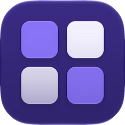
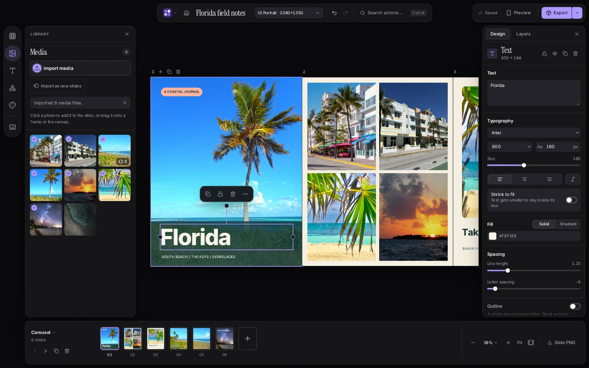
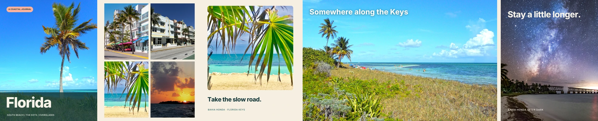
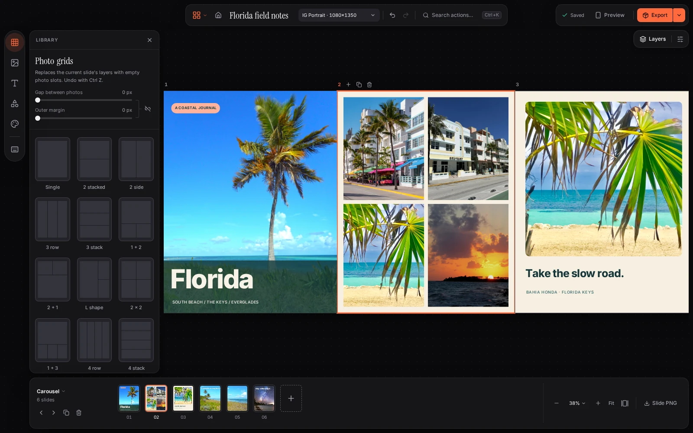
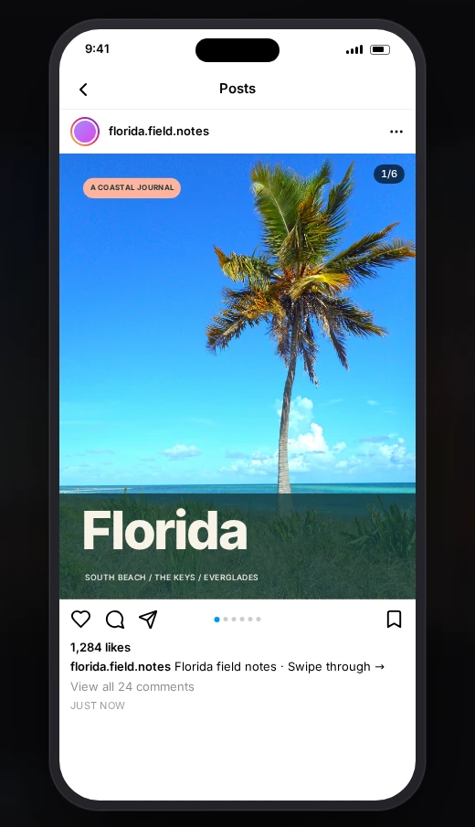
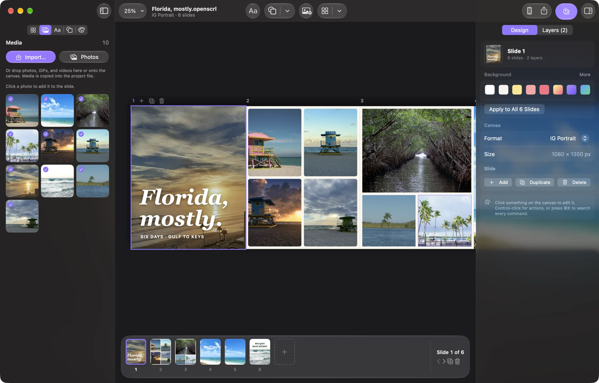

<p align="center">
  
</p>

<h1 align="center">Open-SCRL</h1>

<p align="center">
  Photo carousels and grids for socials, made on your own device.<br />
  No account, no subscription, nothing uploaded.
</p>

<p align="center">
  <a href="https://github.com/HeyPortal/open-scrl/actions/workflows/ci.yml"></a>
  <a href="https://github.com/HeyPortal/open-scrl/releases"></a>
  <a href="https://github.com/HeyPortal/open-scrl/releases"></a>
  <a href="./LICENSE"></a>
</p>



A free, open-source alternative to [SCRL](https://scrl.com), available as a web app for
desktop and phones and a native Mac app.
Lay your photos out across a row of slides, then export one file per slide in posting order.
The web editor uses Studio’s dark stage, floating tool and Properties cards,
lilac selection controls, and slide timeline on desktop, with touch sheets
on phones. It's early, so expect rough edges.
Create a carousel or pick up a saved project from the [home screen](docs/images/web-home.webp).



<sub>Slides 4 and 5 are one photo. Wide shots can span slides and line up at the seams.</sub>

- 25 grid layouts, with gap and margin you can change after the photos are in
- Text with outlines, shadows, gradients, and highlight boxes
- Photo masks, borders, and blurred-photo backgrounds
- [Export settings](docs/web-export.md) for PNG/JPEG, resolution, slide selection, and MP4 animations
- A phone preview of the feed, story, and profile grid crop

<table>
  <tr>
    <td width="62%"></td>
    <td width="38%"></td>
  </tr>
</table>

## What's new in 2.0

[Open-SCRL 2.0 for Web](https://github.com/HeyPortal/open-scrl/releases/tag/web-v2.0.0)
is a redesign of the web app on desktop and phones:

- **A new look.** A calm dark design with floating tool and Properties cards, a slide
  timeline, and the Mac app's icon as the web logo.
- **Home screen.** Create a carousel from one row or start from a photo grid. Recent
  projects show as strips of their opening slides, with search, sorting, and grid or
  list views.
- **Export.** Preview the whole carousel as one panorama, pick slides, choose PNG or
  JPEG, size and quality, rename the download, and cancel at any time.
- **Phone editor.** Touch sheets, pinch to zoom, two-finger scale and rotate, and more
  reliable photo and text selection.
- **Safer updates.** Updates wait until saving, imports, exports, and edits in
  progress have finished.

## On your phone

The web app has its own phone home screen and editor, with photo and grid tools in
bottom sheets. Drag layers to arrange them, pinch to zoom, use two fingers to scale
and rotate a selected layer, and double-tap text to type in place. Turn the phone
sideways to put the tools beside the canvas.

<table>
  <tr>
    <td width="50%"></td>
    <td width="50%"></td>
  </tr>
</table>

Export one slide or a whole carousel as downloaded files. The app saves projects
in the browser and waits for unfinished edits before offering an update.
[Mobile controls and limitations](./docs/mobile.md).

## Mac app



A separate SwiftUI app in [`macos/`](./macos). Projects are `.openscrl` files, and it adds
Photos import, AirDrop sharing, and Blend Photos for seamless joins between pictures.
[More details](./docs/mac.md).

[Download the latest DMG](https://github.com/HeyPortal/open-scrl/releases/latest) (macOS 27,
Apple silicon). Builds aren't notarized yet, so allow the first launch in
**System Settings ▸ Privacy & Security**.

## Your data

The web app saves everything in your browser. **Clearing the site's data deletes your
projects.** The Mac app saves everything, photos included, in the `.openscrl` file. The
two apps can't open each other's projects yet.

## Development

### Web app

You need [Bun](https://bun.sh) 1.4 or later and Node 22.12 or later. Bun installs
packages and runs the scripts; Vite, Vitest, and Playwright still run on Node.

```bash
git clone https://github.com/HeyPortal/open-scrl.git
cd open-scrl
bun install
bun run dev        # http://localhost:5173
```

To build and check the production app:

```bash
bun run build      # typecheck and build into dist/
bun run preview    # serve dist/ locally
bun run verify     # typecheck, lint, unit tests, build, and bundle size check
```

Browser tests use Playwright with Chromium. Install the browser once, then run them:

```bash
bunx playwright install --with-deps chromium
bun run test:e2e   # editor tests against the dev server
bun run test:pwa   # production offline and update checks
```

See [Browser testing](docs/testing.md) for focused runs, stress checks, reports,
and viewing failure traces with Bun.

Run unit tests with `bun run test`, not `bun test`: the latter starts Bun's own test
runner instead of Vitest.

### Mac app

Open `macos/OpenSCRL.xcodeproj` in Xcode 27 on macOS 27 and run it, or build from the
command line:

```bash
cd macos
xcodebuild -project OpenSCRL.xcodeproj -scheme OpenSCRL -configuration Release -derivedDataPath build build
Scripts/make-dmg.sh   # package the build as macos/build/dmg/Open-SCRL-<version>.dmg
```

For a phone preview on the same network, open the Network URL printed by Vite.
Image imports and project storage also work at this HTTP preview address.

See [web updates and offline tools](docs/web-updates.md) for reload and caching behavior.
[AGENTS.md](./AGENTS.md) has a tour of the code. The [changelog](./CHANGELOG.md) lists
every Mac release, and web release notes are on the
[Releases page](https://github.com/HeyPortal/open-scrl/releases).

## Credits

The web screenshots use Florida photos from Wikimedia Commons, with
[photographer credits, source links, and licenses](docs/screenshot-credits.md).

The Mac screenshot uses Florida photos from Unsplash by
[John Maldonado](https://unsplash.com/photos/cATp9I27xsU),
[Jota](https://unsplash.com/photos/q5kqK2HHdfw),
[PhotoHound](https://unsplash.com/photos/zNR0WdLZ6vU),
[eileen byrne](https://unsplash.com/photos/fO6XJydV_tU),
[Edgar Serrano](https://unsplash.com/photos/DOqtBkdGCxg),
[Mark Jacquez](https://unsplash.com/photos/H9Tfe4uNJC8),
[Tom Forrest](https://unsplash.com/photos/cACNO2_m_ao),
[Younho Choo](https://unsplash.com/photos/dd7wQyXMKfo),
[Alexander Raissis](https://unsplash.com/photos/wVc2MReIMoU), and
[London Bridges](https://unsplash.com/photos/u4eO1h-n_TY).

## License

[MIT](./LICENSE); [screenshot imagery has separate licenses](docs/screenshot-credits.md).
Not affiliated with SCRL or Instagram.
