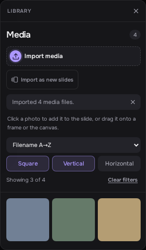
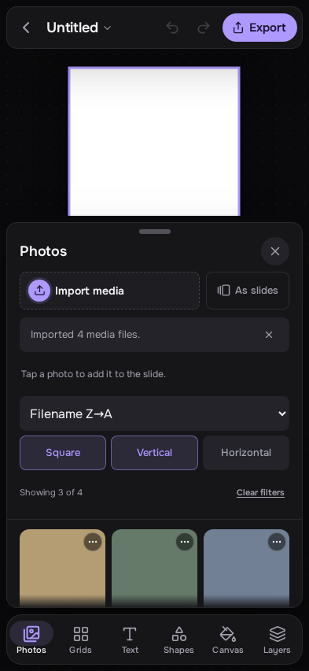

# Sorting and filtering media

Use the Media panel on desktop, or the Photos sheet on a phone, to organize the
current project's library. The native Mac Media sidebar offers the same choices.

**Sort media** offers:

- **None (import order)**: keep the order in which files were imported. This is
  the default; the Mac menu calls it **None**.
- **Filename A→Z** and **Filename Z→A**: natural filename order, so `IMG_2` comes
  before `IMG_10` in ascending order.
- **File type**: group by original format when available, otherwise by the stored
  format, then sort filenames in ascending order within each group.

Select **Square**, **Vertical**, or **Horizontal** to show those shapes. Choices
combine: Square + Vertical shows both. With none selected, the whole library is
visible. **Clear filters** shows everything again without changing the sort.
Square includes width/height ratios from 0.95 through 1.05; the other two shapes
fall below or above that range. Photos, GIFs, and videos use their stored pixel
dimensions, including orientation applied during import.

Sorting and filtering only change the library view. They leave layers, slide
order, and undo history alone. Choices survive closing and reopening the panel
during the current session; they are not saved in project files. Reloading the
web app starts with import order and no filters.

Importing files still imports every supported selection, even when a filter
hides some of them. The web app offers to show hidden imports. **Import as new
slides** / **As slides** and file drops keep the order of the selected files.
Replacing a photo from the library keeps the selected frame's geometry.

For new web HEIC/HEIF imports, the original filename and type are retained as
metadata alongside the editing JPEG. Older converted imports keep their available
JPEG metadata. This does not retain the original HEIC bytes or recover metadata
already discarded by previous imports. Native Mac media keeps its source format.

