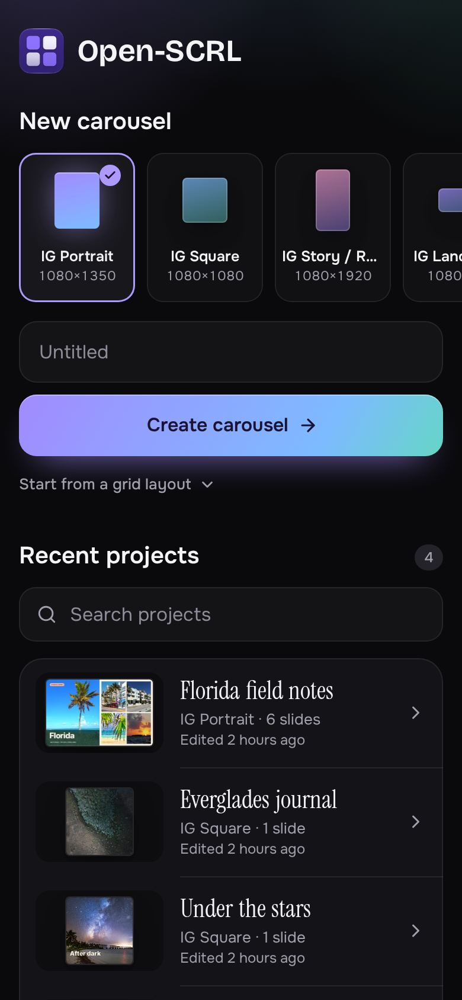
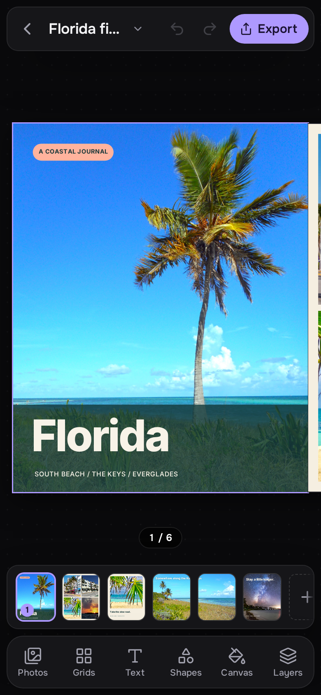
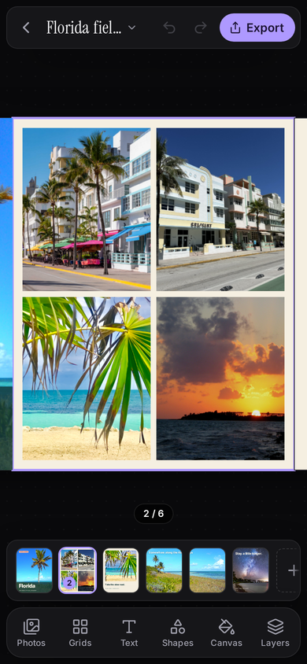
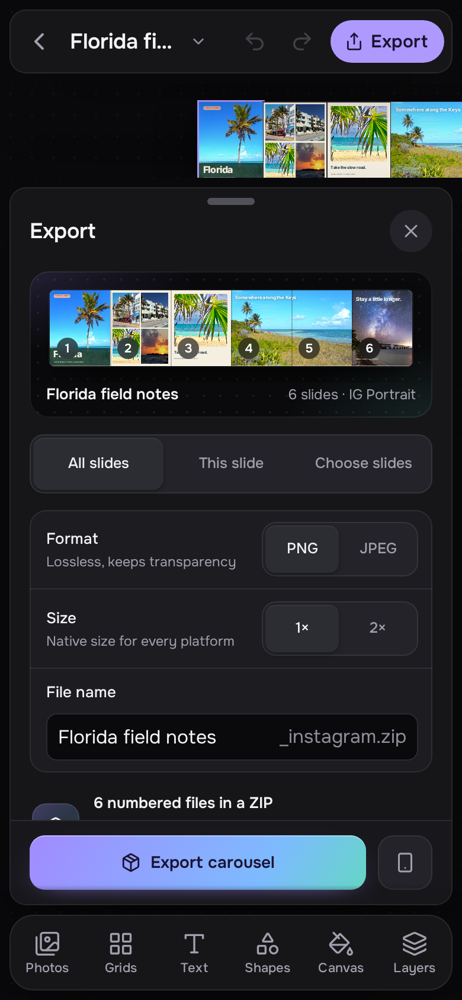

# The mobile layout

The web app uses the dark Studio design with a touch-first layout for phones: its own home screen and editor. It uses the same projects and media as the desktop layout in that browser; rotating or resizing the window keeps the current project open. Projects stay on the device and are not synced between browsers or devices. This page describes how the phone layout works.

| Home screen | Editor |
| --- | --- |
|  |  |

## When the mobile layout is used

The mobile layout is used when the browser window is 767 px wide or narrower, or when the screen is a touch screen 500 px tall or less (a phone turned sideways). Tablets in portrait, and wider windows, get the desktop editor. The check runs as the window changes size, so rotating a phone switches layouts without closing the open project.

## Home screen

The page keeps its dark background while the app and bundled fonts get ready, without a loading splash or default browser text.

- **New carousel**: pick a canvas size from the cards (IG Portrait, IG Square, IG Story / Reels, IG Landscape, TikTok, or Pinterest; swipe sideways for the rest), type a name, and tap **Create carousel**. A blank name keeps the project called Untitled. Scrolling past the card shows a floating **New carousel** button above the bottom edge that scrolls back up to it; it hides while the keyboard is open.
- **Start from a grid layout**: expand this section to choose from eight photo layouts, such as a 2 × 2 grid or a 1 + 2 layout. Tapping one creates a project in the chosen size with that grid already placed.
- **Recent projects**: each row shows the opening slides as a small strip (two or three for portrait and story carousels), the name, canvas size, slide count, and when it was last edited ("Edited 2 hours ago"). Tap a row to open it. A search box appears once you have more than three projects, with **Clear search** when nothing matches. Previews are drawn on the device only for rows near the screen.

The footer reads "Saved on this device. Nothing is uploaded." Clearing the site's data in that browser deletes them.

## Editor layout

The top bar, slide strip, dock, selection bar and sheets are dark glass islands
on a dotted stage, with lilac actions and selection outlines. They stay in flow
so the canvas measures the space available. The home screen uses the Mac app
icon with blue, teal and pink format previews and grid diagrams.

- **Top bar**: the back chevron returns to the home screen. The project name opens the **Project** sheet, which renames the project, sets the canvas format, and has **Back to projects**. A dot after the name shows while changes are saving or after a save has failed. **Undo** and **Redo** are icon buttons, and **Export** opens the export sheet.
- **Canvas**: the slides sit side by side with the selected one centered. A counter such as "2 / 5" appears below the canvas when there is room.
- **Slide strip**: a thumbnail for each slide, then a + button to add one. See [Slides](#slides).
- **Dock**: six tabs, **Photos**, **Grids**, **Text**, **Shapes**, **Canvas**, and **Layers**. Each opens a sheet. Tap the active tab again to close its sheet.
- **Selection bar**: replaces the dock while a layer is selected. See [Selecting and editing](#selecting-and-editing).

A sheet rises from the dock and the canvas shrinks to make room. The slide strip hides while a sheet is open. Most sheets open at half height; Export opens at full height. Drag the handle or title bar up to expand a sheet to full height, or down to collapse it. Drag further down, or tap the X, to close it. Tapping the handle or title bar toggles between half and full height.

## Adding photos, grids, text, shapes, and backgrounds

- **Photos**: the large **Import media** drop zone opens the file picker for images, GIFs, and videos. **As slides** imports each file onto its own new slide, and panoramas span as many slides as they need. Tap a photo to add it to the current slide. The ⋯ button in a photo's corner offers **Add to slide**, **Spread across N slides**, **New slide with this**, and **Remove from project**. When a photo frame is selected, the menu also offers to fill or replace it. Files stay on the device.
- **Grids**: tap a grid to apply it to the current slide. This replaces the slide's layers with empty photo frames. Open **Spacing** to set the gap and margin the grid uses. To fill an empty frame, select it and then tap a photo in **Photos**.
- **Text**: **Add text box** adds a box that reads "Double-tap to edit". The style presets below it work two ways. With a text layer selected, a preset replaces that layer's text, size, and weight. Otherwise it adds a new box. Inter is bundled with the app, including italics, so it uses the same face while editing and in exported images and videos. Existing Inter text also uses the bundled face; its line wrapping may change from the previous fallback font.
- **Shapes**: tap a shape to add it to the slide.
- **Canvas**: sets the background of the current slide to a color, gradient, photo, or none. **Apply to all N slides** copies it to every slide.

## Selecting and editing

Tap a layer on the canvas to select it. The selection bar starts with a label (Photo, Text, Shape, Group, or the number of layers) followed by four actions and **Done**:

- **Edit**, **Delete**, and **Duplicate** (**Replace**, or **Add photo** on an empty frame, for a photo)
- **More** opens a menu with **Forward**, **Backward**, and **Lock** (or **Unlock**), plus **Group** and **Ungroup** when they apply, and **Duplicate** for a photo. Escape or a tap outside closes it.
- **Done** clears the selection.

**Edit** opens a properties sheet titled Photo, Text, Shape, Layer, or "N layers". It holds the desktop inspector's controls with larger targets. In a photo's section, **Replace** (or **Choose photo** for an empty frame) opens **Photos**.

To replace a photo, select it and tap **Replace**. The Photos sheet then reads "Tap a photo to replace" the frame. Tapping another photo swaps it in. Tapping the photo already there duplicates it. **Add new instead** cancels the replace and adds a new layer.

On the canvas, one finger selects one layer at a time. To select several, open **Layers**, tap **Select**, and tap the layers you want.

## Canvas gestures

- **Tap** a layer to select it. Tap empty canvas to clear the selection and select the slide under your finger.
- **Drag** a layer to move it, with snapping. Dragging an unselected layer selects it first.
- **Drag** empty canvas to pan. At fit zoom, a slow swipe settles on the nearest slide, and a quick flick moves one slide.
- **Pinch** on empty canvas to zoom around your fingers. Pinching together past the fit view shows several slides side by side. Pinching back to near fit snaps to fit.
- **Two fingers on a selected layer**: if one unlocked layer is selected and your fingers start on or just around it, pinching scales it, twisting rotates it (snapping to 45° when within 4°), and moving both fingers moves it. Releasing commits the whole change as a single undo step. Two fingers that start elsewhere zoom the canvas instead.
- **Double-tap** a text layer to edit it in place. The box grows with the text and stays within the screen above the keyboard. Tap **Done** above it, or tap outside it, to finish.
- **Double-tap** empty canvas while zoomed in to return to the fit view. At fit zoom, a double-tap does nothing extra.

Touch selection follows the current position, rotation, and stacking order of the visible layers. A title above a photo remains selectable, including after moving layers or reopening a project. Layers moved across slide boundaries can be selected, dragged, and edited where they appear; selecting them keeps the canvas on the slide you are viewing.

The browser's own pinch-zoom is turned off on the canvas, so pinching only changes the canvas.

After an interrupted touch, you can select or move a layer again without refreshing the page. A handle resize interrupted by the browser keeps its last visible size.

A pan, pinch, two-finger layer change, handle resize, layer drag, or unfinished text edit counts as work in progress: a new version of the app waits to be offered until it finishes (see [web updates](./web-updates.md)). Interrupted drags and two-finger transforms are discarded. Text typed in place is kept when you tap **Done** or elsewhere; a hardware **Escape** key, or opening another project, discards it.

## Slides

- **Select**: tap a thumbnail. The strip keeps the selected one centered.
- **Add**: the + at the end of the strip adds a blank slide after the selected one and selects it.
- **Duplicate, move, or delete**: tap the selected thumbnail to open its menu with **Duplicate**, **Move left**, **Move right**, and **Delete**. Move left and Move right are dimmed at the ends, and Delete is off when only one slide is left. Slides are reordered from this menu, not by dragging.

## Layers

The **Layers** sheet lists the current slide's layers, top layer first. Tap a row to select it, and drag its grip to reorder. Each row has lock and visibility buttons. The selected row also shows **Duplicate**, **Delete**, and **Edit properties**. Group rows have a chevron to expand or collapse them. The **Select** button in the sheet header turns on multi-select.

## Export and phone preview

**Export** in the top bar opens the full-height export sheet. It has the same
[export settings](./web-export.md) as desktop. Everything is rendered on the device.

- The carousel appears as one panorama at the top. Slides left out of the export are dimmed.
- **All slides** downloads a ZIP; **This slide** saves one file; **Choose slides** downloads a ZIP of the slides you tap in the panorama, keeping their original numbers.
- Choose **PNG** or **JPEG**, a **1×** or **2×** size, and JPEG quality. Animated slides can stay **MP4** or become **Still** frames; MP4 keeps the original canvas size.
- **File name** changes the download name. The summary shows the output size and name before export.
- **Cancel export** stops a running export. Progress, completion, and errors appear in the sheet; after a failure you can retry.
- The phone icon beside the export button opens **Preview on phone**, with Feed (Story for story formats) and Profile grid views. Swipe to move between slides.

Files download through the browser. Nothing is saved to Photos.

## Landscape

On a phone turned sideways, the sheet opens as a panel on the right, about 46% of the screen width and no wider than 380 px, with the canvas on the left. The top bar and dock shrink, and the slide counter is hidden because there is no room for it.

## Known limitations

- Projects can't be renamed or deleted from the home screen. Rename an open project from the **Project** sheet.
- Exports download as files. They are not saved to Photos.
- Two-finger transform works on one unlocked layer at a time. With several layers selected, two fingers zoom the canvas.
- Selecting several layers on touch is done through the **Layers** sheet, not by dragging a box on the canvas.
