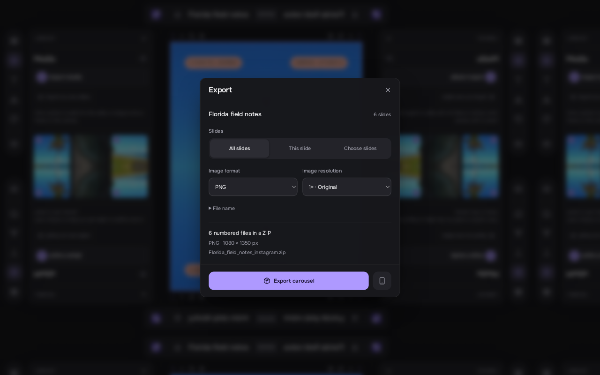

# Web export

Click **Export** in the desktop toolbar, or tap it in the phone top bar.
Desktop also supports **Ctrl/Cmd + Shift + E**. The dialog and phone sheet
share the same settings. All rendering and packaging happen on your device.

- **All slides** downloads a ZIP in posting order. **This slide** downloads
  the selected slide directly. **Choose slides** exports only the checked
  slides in a ZIP; their original numbers stay intact (`01`, `03`, etc.).
- **PNG** preserves transparency. **JPEG** fills transparent areas white
  and lets you set quality from 50% to 100% (92% by default).
- **Image resolution** is **1×** the canvas size or **2×** for more pixels.
  An IG Portrait image becomes 1080 × 1350 or 2160 × 2700 pixels. This
  changes the exported file, without changing the project or photo source.
- **Animated slides** appears when a selected slide contains a GIF or video.
  Keep animations as MP4, or export still frames in the chosen image format.
  MP4 stays at the original canvas dimensions. Browser WebCodecs/H.264
  support is required for MP4; if unavailable, choose still frames.
- Expand **File name** to rename the download. ZIPs use
  `<name>_instagram.zip`; individual files use `<name>_01.png`, `.jpg`, or
  `.mp4`. Spaces and punctuation become underscores.

The summary shows file count, dimensions, and the download name. Image
format, quality, resolution, and animation preferences last for the current
app session. The timeline's **Slide PNG** button remains a quick PNG export
at the original canvas size.

Progress appears during rendering and packaging. **Cancel export** stops
work before a download is issued and releases its resources. Once the browser
has received a download, manage it through the browser. A failed export
shows its error and can be retried. Closing the settings while an export runs
keeps it running; reopen Export to see progress or cancel.

Files download through the browser rather than going directly to Photos.
For the phone layout, see [mobile controls](./mobile.md#export-and-phone-preview).
